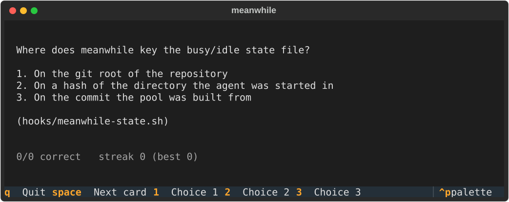
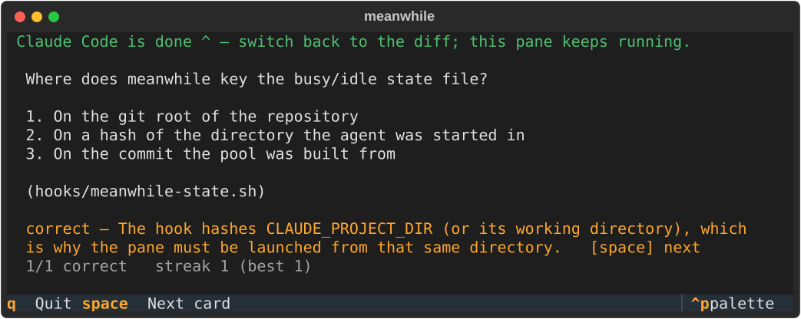

# meanwhile

A quiz about your own repository that you play while your coding agent works,
so the code is still fresh in your head when the diff lands. Works with
Claude Code, Codex, Cursor and OpenCode.

<p align="center">
  
</p>

<p align="center">
  
</p>

## Quick start

Three steps, once per machine and project:

1. **Connect your agent** — see [Installation](#installation) for your agent.
2. **Build the question pool**, once per project:
   - Claude Code: run `/meanwhile-build`
   - any other agent: run `uvx meanwhile-cli build-prompt --lang en --repo .`
     and paste the output to your agent
3. **Open a second terminal** in the same directory as your agent and run:

   ```
   uvx meanwhile-cli
   ```

The pane starts asking questions right away. When your agent finishes a
prompt, the pane tells you so you can switch back to the diff.

## Installation

You need [uv](https://docs.astral.sh/uv/) for the `uvx` commands. Then pick
your agent:

### Claude Code

```
/plugin marketplace add ismailbayram/meanwhile
/plugin install meanwhile@meanwhile
```

Restart Claude Code.

### Codex

```
codex plugin marketplace add ismailbayram/meanwhile
```

Install `meanwhile` from the Plugins Directory, then **review and trust its
hooks** — Codex skips plugin hooks until you do.

### Cursor

```
uvx meanwhile-cli hooks install --agent cursor
```

### OpenCode

```
uvx meanwhile-cli hooks install --agent opencode
```

Restart OpenCode.

### Installing the command permanently (optional)

`uvx` runs the latest version without installing anything. If you prefer a
regular command:

```
uv tool install meanwhile-cli    # or: pipx install meanwhile-cli
```

The command is then just `meanwhile` — use it wherever this README says
`uvx meanwhile-cli`.

## Usage

| Key | Action |
| --- | --- |
| `1`–`9` | answer |
| `space` | next card |
| `q` | quit |

- Start the pane **from the same directory you started your agent in**,
  otherwise it cannot tell when the agent is done. The quiz itself works
  either way.
- Leave it open all day. Each new prompt after the agent finishes deals a
  fresh round; when the pool runs out, `space` starts a new one.
- The interface follows the pool's language. Override it with
  `--lang tr` or `--lang en`.

## The question pool

`/meanwhile-build` (or `build-prompt`) has the agent read your repository and
write `.meanwhile/pool.json` — 30 to 50 multiple-choice questions. An entry
looks like this:

```json
{
  "type": "quiz",
  "q": "What happens to an order's reserved stock when payment fails?",
  "choices": [
    "It stays reserved until an admin releases it",
    "It is released back to inventory after 15 minutes",
    "It is released immediately and the order is cancelled"
  ],
  "answer": 1,
  "why": "release_expired_reservations runs every 15 minutes and returns unpaid stock to inventory.",
  "source": "shop/orders/tasks.py"
}
```

- **Commit `pool.json`** so the whole team plays the same pool and nobody pays
  to build it again.
- **Language:** `--lang` takes a language code, not a name. `tr` and `en` are
  the two the interface speaks; any other code (`de`, `fr`, …) writes the
  questions in that language and keeps the interface in English.
- **Adding questions:** run the build step again. When a pool already
  exists it keeps every question and adds 30 new ones. Ask your agent for
  "a fresh pool" if you want to replace it instead.
- **Refreshing:** when the repository is about 50 commits past the pool, the
  pane shows a banner. Run the build step again and commit the new file.
  Nothing is regenerated automatically.
- **Repeats:** within a round no question repeats. Across rounds, questions
  you have not answered yet come first; once you have answered them all, it
  starts over.
- Scores and the answered-question list are kept in
  `.meanwhile/scores.json`, which is gitignored.

## Commands

| Command | What it does |
| --- | --- |
| `uvx meanwhile-cli` | open the quiz pane |
| `uvx meanwhile-cli build-prompt --lang en --repo .` | print the pool-building instructions for any agent |
| `uvx meanwhile-cli validate --repo .` | check `pool.json` |
| `uvx meanwhile-cli hooks install --agent <agent>` | connect an agent without its plugin (`claude`, `codex`, `cursor`, `opencode`); add `--user` for every project (not Cursor) |
| `uvx meanwhile-cli hooks status` | show which agents are connected |
| `uvx meanwhile-cli hooks uninstall --agent <agent>` | disconnect |

`hooks install` writes an absolute path from your machine into the agent's
config, so don't commit that file for Codex, Cursor or OpenCode.

## How it works

Hooks in your agent write `busy` or `idle` to a small file in
`~/.meanwhile/state/` when you send a prompt and when the agent finishes. The
pane watches that file and shows cards from `pool.json`. Only the build step
uses an LLM; the pane makes no network calls.

## Development

From a checkout of this repository, use `uv run meanwhile` in place of
`uvx meanwhile-cli`, and `/plugin marketplace add /path/to/meanwhile` for the
Claude Code plugin. Tests: `uv run --extra dev python -m pytest`.
